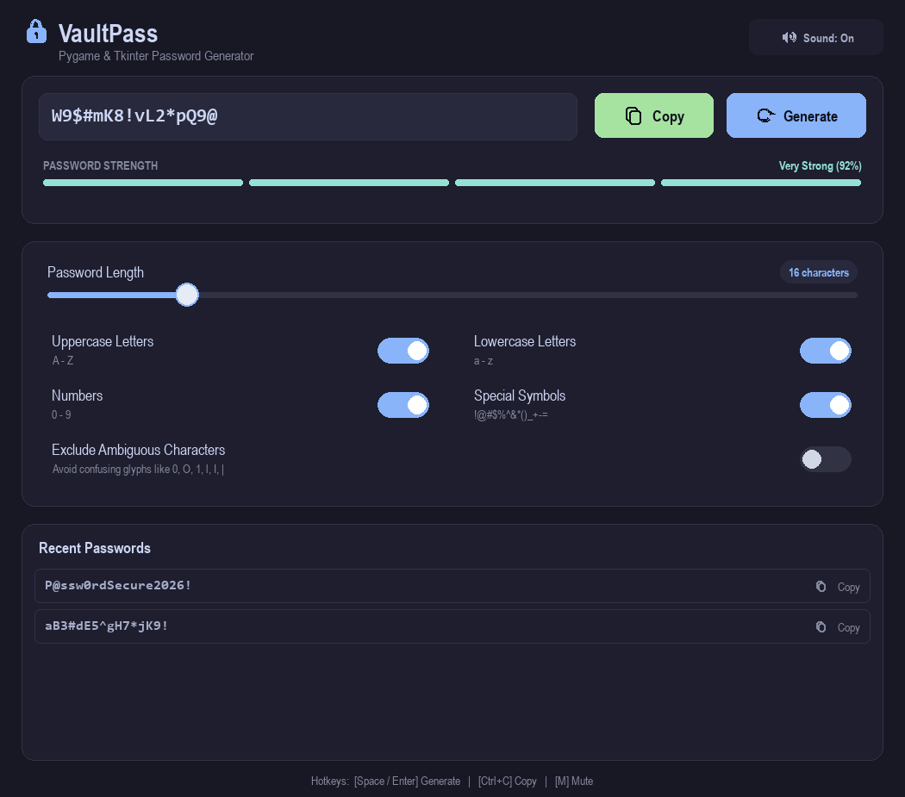

# 🔐 VaultPass — Modern Dark-Mode Password Generator

An interactive, high-DPI desktop password generator built using **Pygame** for the graphical interface, animations, and sound effects, paired with **Tkinter** for headless operating system clipboard synchronization.



---

## ✨ Features

- **🛡️ Cryptographically Secure**: Uses Python’s standard `secrets` module (`secrets.SystemRandom` backed by OS-level entropy: `CryptGenRandom` / `/dev/urandom`) rather than insecure pseudo-random generators (`random`).
- **🎛️ Fully Customizable**:
  - Length slider ranging from **6 to 64 characters** (default: 16).
  - Independent toggles for **Uppercase** (`A-Z`), **Lowercase** (`a-z`), **Digits** (`0-9`), and **Symbols** (`!@#$%^&*()_+-=[]{}|;:,.<>?`).
  - **Exclude Ambiguous Characters**: Filter out confusing lookalike glyphs (`0`, `O`, `o`, `1`, `l`, `I`, `|`, etc.) to prevent manual typing errors.
- **📊 Real-Time Strength Meter**: Calculates Shannon Information Entropy ($H = L \times \log_2(N)$) and NIST-aligned strength ratings (*Very Weak*, *Weak*, *Fair*, *Strong*, *Very Strong*) with smooth color-coded gauge segments.
- **📋 Headless Clipboard Integration**: Copies generated passwords directly to the Windows clipboard via a backgrounded Tkinter instance (`root.withdraw()`) without displaying extra desktop windows.
- **🔔 Floating Toast Feedback**: Smooth non-blocking on-screen pop-in notification with alpha fading confirming clipboard copy actions.
- **🕒 Password History Panel**: Keeps track of the last 4 generated passwords for quick retrieval with one-click copy buttons.
- **🎵 In-Memory Procedural Audio**: Synthesizes 16-bit PCM waveforms mathematically in RAM (button taps, toggle blips, copy chimes, and generation sweeps) without requiring external `.wav` or `.mp3` files, complete with a mute toggle.
- **🖥️ Native High-DPI Scaling**: Integrates Windows Per-Monitor DPI awareness (`SetProcessDpiAwareness(2)`) to dynamically scale layout coordinates and render razor-sharp text and custom procedural vector icons (no missing emoji boxes `[]`).

---

## 📁 Project Structure

```
VaultPass/
├── main.py                     # Application entrypoint, 60 FPS event loop & DPI scaling
├── generator.py                # Cryptographic password generator & entropy assessment
├── ui.py                       # Reusable Pygame UI components & vector icons
├── sound.py                    # Procedural in-memory audio wave synthesizer
├── clipboard_helper.py         # Headless Tkinter clipboard integration bridge
├── test_generator.py           # Automated unit test suite (7/7 tests passing)
├── requirements.txt            # Python dependencies (pygame>=2.5.0)
├── run.bat                     # 1-click double-click application launcher
├── open_in_vscode.bat          # 1-click VS Code folder launcher
├── preview.png                 # High-DPI UI preview screenshot
├── README.md                   # Project documentation
└── VaultPass_Project_Report.docx # Formatted academic project report (Word format)
```

---

## 🚀 Getting Started

### Prerequisites

- **Python 3.10+** installed on your system.
- **Pygame** (Version 2.5.0 or higher).

### Installation

Clone or navigate to the project directory:

```powershell
cd C:\Users\avina\Documents\antigravity\jolly-euclid\VaultPass
```

Install the dependencies:

```powershell
pip install -r requirements.txt
```

---

## 🎮 How to Run

### Option 1: Double-Click Launcher (Easiest)
Simply double-click **`run.bat`** in the project folder.

### Option 2: Via Terminal (PowerShell / Command Prompt)
```powershell
python main.py
```

### Option 3: Via Windows Run Dialog
Press <kbd>Win</kbd> + <kbd>R</kbd>, paste the following command, and press **Enter**:
```cmd
cmd /c "cd /d C:\Users\avina\Documents\antigravity\jolly-euclid\VaultPass && python main.py"
```

---

## ⌨️ Keyboard Shortcuts

| Shortcut | Action |
| :--- | :--- |
| <kbd>Space</kbd> or <kbd>Enter</kbd> | Generate a new password |
| <kbd>Ctrl</kbd> + <kbd>C</kbd> | Copy current password to clipboard |
| <kbd>M</kbd> | Toggle audio mute / unmute |

---

## 🧪 Running Automated Tests

Run the unit test suite to verify length constraints, pool containment, glyph exclusion, entropy scoring, audio synthesis, and clipboard operations:

```powershell
python test_generator.py
```

Expected output:
```text
Ran 7 tests in 0.58s

OK
```

---

## 📐 How It Works

### 1. Cryptographic Entropy & Strength Assessment
Shannon entropy $H$ is computed dynamically:
$$H = L \times \log_2(N)$$
Where:
- $L$ = Password length (6–64)
- $N$ = Effective character pool size:
  - Uppercase: 26
  - Lowercase: 26
  - Digits: 10
  - Symbols: 27

Passwords are categorized into NIST-aligned tiers:
- **Very Weak (<25%)**: Low entropy, short string.
- **Weak (25–49%)**: Limited character diversity.
- **Fair (50–69%)**: Moderate length with multiple character sets.
- **Strong (70–89%)**: High entropy exceeding 65 bits.
- **Very Strong (90–100%)**: Length $\ge$ 16 with all 4 classes active.

### 2. Procedural Audio Synthesis
All audio effects are synthesized in memory using Python's `math`, `struct`, and `wave` modules without external assets:
- **Micro-Click (0.025s)**: $1800 \to 800\text{ Hz}$ linear pitch drop for button taps.
- **Toggle Blip (0.04s)**: $650 \to 1050\text{ Hz}$ rising blip for switches.
- **Copy Chime (0.22s)**: Harmonic chord ($880\text{ Hz} \to 1320\text{ Hz}$) confirming copy.
- **Generator Whoosh (0.08s)**: Sinusoidal frequency sweep simulating spinning generation.

---

## 📄 License

This project is licensed under the MIT License — feel free to modify and distribute for personal and educational use.
